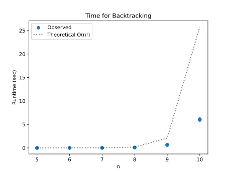
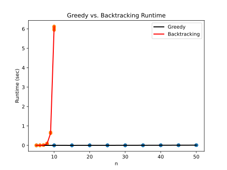
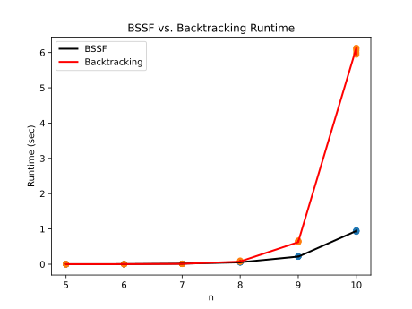

# Project Report - Backtracking

## Baseline

### Design Experience

* I met with Lily Nahoopii, and we mostly discussed how the greedy algorithm works for TSP. We made sure
we were on the same page about running the algorithm from all the different possible starting nodes
and always picking the next shortest path. 

### Theoretical Analysis - Greedy

#### Time 

* **O(n^3)** - The algorithm loops through all the different possible starting nodes, which is O(n), and
then for each of those nodes, it finds the next shortest path O(n) until it has gotten back to the starting
node O(n). So in total, the algorithm is O(n^3)

```python 
def get_min_index(weights, current, visited):  # time - O(n)
    min_weight = float('inf')
    min_index = len(weights)
    for i, weight in enumerate(weights):  # time = O(n) 
        if weight < min_weight and i != current and i not in visited:
            min_weight = weight
            min_index = i
    return min_index


def greedy_tour(edges: list[list[float]], timer: Timer) -> list[SolutionStats]: # time = O(n^3), space = O(n^2)
    solutions = []  # space = O(n^2) - holds up to n solutions each of length n
    best = float('inf')
    for i in range(len(edges)):  # time = O(n) - tries all possible starting positions 
        visited = set()  # space = O(n)
        visited.add(i)
        current = i
        solution = [i]  # space = O(n)
        while len(visited) != len(edges):  # time = O(n)
            next_node = get_min_index(edges[current], current, visited)  # time = O(n)
            if next_node == len(edges):  # no neighbors
                break
            current = next_node
            visited.add(current)
            solution.append(current)
        time_out = timer.time_out()
        if time_out:
            return solutions
        else:
            score = score_tour(solution, edges)
            time = timer.time()
            if len(solution) == len(edges) and edges[current][i] != float('inf') and score < best:
                solutions.append(SolutionStats(solution, score, time, 0, 0, 0, 0, 0))
                best = score
    return solutions
```

#### Space
* **O(n^2)** - The data structure that takes up the most space is Solutions. This holds up to n
possible solutions, each of which is of length n, so the overall space complexity is O(n^2)

```python
def greedy_tour(edges: list[list[float]], timer: Timer) -> list[SolutionStats]: # time = O(n^3), space = O(n^2)
    solutions = []  # space = O(n^2) - holds up to n solutions each of length n
    best = float('inf')
    for i in range(len(edges)):  # time = O(n) - tries all possible starting positions 
        visited = set()  # space = O(n)
        visited.add(i)
        current = i
        solution = [i]  # space = O(n)
        while len(visited) != len(edges):  # time = O(n)
            next_node = get_min_index(edges[current], current, visited)  # time = O(n)
            if next_node == len(edges):  # no neighbors
                break
            current = next_node
            visited.add(current)
            solution.append(current)
        time_out = timer.time_out()
        if time_out:
            return solutions
        else:
            score = score_tour(solution, edges)
            time = timer.time()
            if len(solution) == len(edges) and edges[current][i] != float('inf') and score < best:
                solutions.append(SolutionStats(solution, score, time, 0, 0, 0, 0, 0))
                best = score
    return solutions
```

### Empirical Data - Greedy

| Size | Reduction | Time (sec) |
|------|-----------|------------|
| 5    | 0         | 0.0        |
| 10   | 0         | 0.0        |
| 15   | 0         | 0.0        |
| 20   | 0         | 0.001      |
| 25   | 0         | 0.002      |
| 30   | 0         | 0.002      |
| 35   | 0         | 0.004      |
| 40   | 0         | 0.005      |
| 45   | 0         | 0.007      |
| 50   | 0         | 0.009      |


### Comparison of Theoretical and Empirical Results - Greedy

- Theoretical order of growth: O(n^3)
- Empirical order of growth (if different from theoretical): O(n^2.5) - The growth was in between n^2 and n^3, 
and I think this difference might stem from the min_index function not actually taking O(n) time on average. Since visited
gets bigger each iteration, the min_index function only has to consider half of the indices on average. 

## Core

### Design Experience

* I met with Lily Nahoopii, and we talked about the differences between the greedy and backtracking algorithms. 
We talked about how we basically just needed to use a stack instead of a queue to figure out which path to expand next

### Theoretical Analysis - Backtracking

#### Time 

* **O(n^2*n!)** - There is no pruning in this step, so each node looks at each remaining node: (n to n-1, n-1 to n-2, etc) resulting in
a factorial complexity that is also represented in the stack. The n^2 comes from copying the current route to put back on the stack

```python
def dfs(best, timer, edges, is_bssf):
    solutions = []  # space = O(n^2) - up to n solutions each of size n
    stack = [[0]]  # up to n!
    while stack and not timer.time_out():
        current = stack.pop()
        last_node = current[-1]
        visited = set()
        for node in current:  # Time - up to O(n)
            visited.add(node)
        for i in range(1, len(edges)):  # Time - up to O(n)
            if i not in visited:
                if is_solution(current, i, last_node, edges):
                    solution = current.copy()  # space / time = O(n)
                    solution.append(i)
                    score = score_tour(solution, edges)
                    if score < best:
                        best = score
                        time = timer.time()
                        solutions.append(SolutionStats(solution, score, time, 0, 0, 0, 0, 0))
                else:
                    possible_path = current.copy()  # space / time = O(n)
                    possible_path.append(i)
                    if not is_bssf or score_tour(possible_path, edges) < best:
                        stack.append(possible_path)
    return solutions
```

#### Space

* **O(n!)** The stack grows at the same rate as the possible paths do. At most, the stack could have n! things on it. 

```python
def dfs(best, timer, edges, is_bssf):
    solutions = []  # space = O(n^2) - up to n solutions each of size n
    stack = [[0]]  # up to n!
    while stack and not timer.time_out():
        current = stack.pop()
        last_node = current[-1]
        visited = set()
        for node in current:  # Time - up to O(n)
            visited.add(node)
        for i in range(1, len(edges)):  # Time - up to O(n)
            if i not in visited:
                if is_solution(current, i, last_node, edges):
                    solution = current.copy()  # space / time = O(n)
                    solution.append(i)
                    score = score_tour(solution, edges)
                    if score < best:
                        best = score
                        time = timer.time()
                        solutions.append(SolutionStats(solution, score, time, 0, 0, 0, 0, 0))
                else:
                    possible_path = current.copy()  # space / time = O(n)
                    possible_path.append(i)
                    if not is_bssf or score_tour(possible_path, edges) < best:
                        stack.append(possible_path)
    return solutions
```

### Empirical Data - Backtracking

| Size | Reduction | Time (sec) |
|------|-----------|------------|
| 5    | 0         | 0.001      |
| 6    | 0         | 0.002      |
| 7    | 0         | 0.011      |
| 8    | 0         | 0.081      |
| 9    | 0         | 0.645      |
| 10   | 0         | 6.046      |



### Comparison of Theoretical and Empirical Results - Backtracking

- Theoretical order of growth: n!*n^2
- Empirical order of growth (if different from theoretical): same as theoretical

### Greedy v Backtracking

* The greedy algorithm ran much faster than the backtracking algorithm (polynomial time vs factorial time)



### Water Bottle Scenario 

#### Scenario 1

**Algorithm:** Backtracking 

* There are only 8 different locations that need to be visited, which is a very small space to search. It also says
that they need the best possible solution, and greedy will always find a solution (if possible), but it may not be the best
possible solution. 

#### Scenario 2

**Algorithm:** Greedy

* The company needs a solution as fast as possible, and the greedy algorithm runs much faster than the backtracking one. They
also need to connect a lot of nodes and don't care if the solution is the absolute best possible solution. 

#### Scenario 3

**Algorithm:** Backtracking 

* They value having the best possible solution, and greedy doesn't guarantee that. Pruning would also be helpful
in this case since there are so many road closures.

## Stretch 1

### Design Experience

* I met with Lily Nahoopii, and we talked about how the bssf algorithm differs from the regular
backtracking algorithm. We talked about breaking the function into a dfs function that can be used
by the 2 functions. 

### Demonstrate BSSF Backtracking Works Better than No-BSSF Backtracking 



### BSSF Backtracking v Backtracking Complexity Differences

* BSSF and regular backtracking mostly have the same complexity since they use the same basic dfs algorithm,
but BSSF relies on the greedy algorithm running first, which is about n^3 time. However, BSSF also stops considering
paths that are already worse than the current best solution, making it more efficient in that aspect. 

### Time v Solution Cost


* The graph is missing some data points, but it clearly shows that the backtracking algorithm
is able to find more solutions than the random algorithm and the bssf. The greedy algorithm is not clearly shown
in the plot, but I would imagine it would be the fastest of all the algorithms. 

## Stretch 2

### Design Experience

*Fill me in*

### Cut Tree

*Fill me in*

### Plots 

*Fill me in*

## Project Review

* I met with Lily Nahoopii and Salma Fisher. We mostly discussed our implementation of baseline, 
which were all very similar. Lily tried a different approach with the dfs where she kept track of the current
cost as she was searching 
